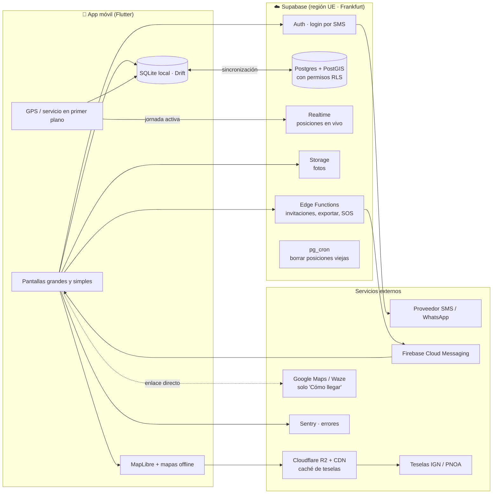
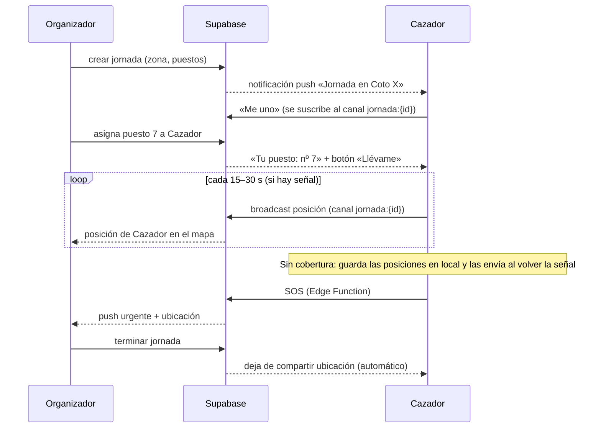

# Arquitectura técnica — App Cazador
 
**Versión:** 0.1 · **Fecha:** 17/11/2026 · **Relacionado:** [PRD.md](PRD.md) (requisitos de producto). Este documento describe *cómo* se construye; el PRD describe *qué* y *por qué*.
 
---
 
## 1. Principios que guían las decisiones
 
1. **Primero sin conexión (offline-first).** En el monte no hay cobertura. La app funciona siempre con los datos del móvil y sincroniza cuando puede.
2. **Pocas piezas.** Un solo lenguaje en la app y un solo proveedor de backend. Un equipo de 1–2 personas tiene que poder mantenerlo.
3. **Coste bajo y predecible.** Servicios gestionados con plan gratis o barato, sin servidores propios que administrar.
4. **Privacidad por diseño.** Datos en la UE. La ubicación en vivo solo se envía durante una jornada activa.
5. **Pensado para móviles Android de gama media**, que son los que tiene el usuario objetivo.
## 2. Vista general
 

 
## 3. Stack elegido
 
| Capa | Elección | Alternativa descartada | Por qué |
|---|---|---|---|
| App móvil | **Flutter 3 (Dart)** | React Native + Expo | Un código para Android e iOS. Rinde bien en móviles baratos. Controla al detalle tamaños de letra y botones grandes |
| Gestión de estado | **Riverpod** | Bloc | Menos código repetitivo y fácil de probar |
| Base de datos local | **Drift (SQLite)** | Isar, Hive | Es SQL de verdad. Permite consultas por zona y la cola de sincronización |
| Mapas | **MapLibre GL** (`maplibre_gl`) | Google Maps SDK, Mapbox | Gratis y de código abierto. **Descarga regiones para usarlas sin conexión** (Google Maps no lo permite) |
| Cartografía | **IGN: PNOA (ortofoto) + MTN (topográfico)**, servidas a través de una caché propia en Cloudflare R2 | Mapbox Satellite | Calidad excelente en España, gratis con atribución. El cazador las reconoce |
| Navegación en coche | **Enlace directo a Google Maps / Waze** | Rutas dentro de la app | 0 € y el usuario ya conoce esas apps |
| GPS | `geolocator` + servicio en primer plano de Android | `flutter_background_geolocation` (licencia de pago) | Gratis y suficiente para el MVP. Se puede cambiar si hay problemas de batería |
| Backend | **Supabase** (Postgres 15 + PostGIS) | Firebase | Las consultas geográficas son nativas (PostGIS). Los permisos se definen en SQL (RLS). Hay región UE. No te ata a un proveedor (es Postgres estándar) |
| Login | **Supabase Auth por teléfono (OTP)**. El SMS se envía mediante el *Send SMS Hook*, con el proveedor más barato | Email + contraseña | Sin contraseñas, que es lo ideal para gente mayor. El hook permite usar un proveedor barato, o WhatsApp |
| Tiempo real | **Supabase Realtime (Broadcast)** | Escribir cada posición en la base de datos | Broadcast no escribe en disco: más barato y rápido. Solo se guarda una posición cada 60 s, como respaldo |
| Ficheros | **Supabase Storage** | S3 | Ya va incluido. Las fotos se comprimen en el móvil a unos 300 KB |
| Lógica de servidor | **Supabase Edge Functions (TypeScript/Deno)** | Servidor Node propio | Sin servidores que mantener |
| Tareas programadas | **pg_cron** | — | Borrar las posiciones de más de 7 días y cerrar jornadas olvidadas |
| Notificaciones | **Firebase Cloud Messaging** | OneSignal | Gratis. Sirve para Android e iOS |
| Enlaces de invitación | **App Links / Universal Links** en dominio propio + página en **Cloudflare Pages** | Firebase Dynamic Links (cerrado por Google) | Si la app no está instalada, el enlace lleva a la tienda |
| Errores | **Sentry** (plan gratis) | Crashlytics | Recoge los errores de la app y de las Edge Functions |
| Analítica | **PostHog (alojado en la UE)** | Google Analytics | Cumple el RGPD y tiene embudos de uso |
| Pagos (fase 2) | **RevenueCat** (dentro de la app) + **Stripe** (plan de coto por web) | — | RevenueCat simplifica las suscripciones de Apple y Google |
| CI/CD | **GitHub Actions + Codemagic** (o Fastlane) | — | Compilar, probar y publicar en las tiendas automáticamente |
| Panel web del organizador (fase 2) | **Next.js + MapLibre GL JS** en Cloudflare Pages | Flutter Web | Mejor en pantallas grandes y para el SEO de la web comercial |
 
## 4. Estructura del repositorio (monorepo)
 
```
app-cazador/
├── app/                      # Flutter
│   ├── lib/
│   │   ├── core/             # tema accesible, router, errores, constantes
│   │   ├── data/
│   │   │   ├── local/        # Drift: tablas, DAOs, cola de sincronización
│   │   │   ├── remote/       # cliente de Supabase
│   │   │   └── sync/         # motor de sincronización
│   │   ├── features/
│   │   │   ├── auth/         # login por teléfono
│   │   │   ├── zonas/        # dibujar, grabar ruta, puntos
│   │   │   ├── compartir/    # enlaces, permisos
│   │   │   ├── grupos/
│   │   │   ├── jornada/      # en vivo, puestos, SOS
│   │   │   ├── capturas/
│   │   │   └── mapas_offline/
│   │   └── main.dart
│   └── test/
├── supabase/
│   ├── migrations/           # SQL versionado (tablas, RLS, funciones)
│   ├── functions/            # Edge Functions
│   └── seed.sql              # datos de prueba
├── web/                      # landing + página de invitación (y panel en fase 2)
└── .github/workflows/
```
 
## 5. Estrategia offline-first
 
**Regla de oro:** la app **siempre lee y escribe en SQLite local**. Nunca espera a la red.
 
1. Cada objeto (zona, punto, captura) se crea con un **UUID generado en el móvil**, así no hace falta conexión para tener un identificador.
2. Cada cambio se guarda en SQLite y además en una tabla `cola_sync`, la *outbox*.
3. Cuando hay red, el motor de sincronización:
   - sube la cola en orden,
   - después baja los cambios del servidor con `updated_at > última_sync`.
4. **Conflictos:** casi no existen, porque **solo el creador puede editar** sus zonas. Si los hubiera, gana el último cambio (*last-write-wins*) según `updated_at`.
5. Los borrados son lógicos (`deleted_at`) para que se propaguen a todos los móviles.
6. **Mapas offline:**
   - Al guardar o recibir una zona, se ofrece «Descargar mapa de esta zona». Se descarga su rectángulo más 1 km de margen, con zoom de 12 a 17 (unos 20–80 MB según el tamaño).
   - Las teselas vienen de nuestra caché en Cloudflare R2 y no directamente del IGN, para no saturar sus servidores. Hay que **verificar sus condiciones de uso masivo** antes del lanzamiento.
## 6. Jornada en vivo
 

 
- **Canal:** `jornada:{id}`, privado. Solo pueden suscribirse los miembros de esa jornada, y se comprueba en el servidor.
- **Batería:** el GPS envía cada 15 s si el cazador se mueve y cada 60 s si está quieto en el puesto. Se usa la precisión «equilibrada».
- **Respaldo:** una Edge Function guarda una posición por minuto en `posicion_en_vivo`, para el SOS y la última ubicación conocida. pg_cron la borra a los 7 días.
- **Cierre automático:** si nadie termina la jornada, se cierra sola a las 12 h.
## 7. Modelo de datos (Postgres + PostGIS)
 
```sql
-- Extensiones
create extension if not exists postgis;
 
create table perfil (
  id uuid primary key references auth.users,
  nombre text not null,
  telefono text unique not null,
  creado_en timestamptz default now()
);
 
create table grupo (
  id uuid primary key,
  nombre text not null,
  dueno_id uuid not null references perfil,
  codigo_invitacion text unique,          -- 6 dígitos
  plan text default 'gratis'
);
 
create table miembro_grupo (
  grupo_id uuid references grupo on delete cascade,
  usuario_id uuid references perfil on delete cascade,
  rol text check (rol in ('dueno','responsable','miembro')),
  primary key (grupo_id, usuario_id)
);
 
create table zona (
  id uuid primary key,                    -- generado en el móvil
  creador_id uuid not null references perfil,
  nombre text not null,
  descripcion text,
  tipo text check (tipo in ('area','ruta')),
  geom geometry(Geometry, 4326) not null, -- Polygon o LineString
  especies text[],
  modalidad text,
  foto_url text,
  updated_at timestamptz default now(),
  deleted_at timestamptz
);
create index on zona using gist (geom);
 
create table punto (
  id uuid primary key,
  zona_id uuid references zona on delete cascade,
  tipo text,                              -- puesto, coche, comedero, peligro…
  nombre text,
  geom geometry(Point, 4326) not null,
  updated_at timestamptz default now(),
  deleted_at timestamptz
);
 
create table acceso (
  zona_id uuid references zona on delete cascade,
  usuario_id uuid references perfil,      -- uno de los dos
  grupo_id uuid references grupo,
  nivel text check (nivel in ('ver','seguir','editar')),
  caduca_en timestamptz,
  check (num_nonnulls(usuario_id, grupo_id) = 1)
);
 
create table jornada (
  id uuid primary key,
  grupo_id uuid references grupo,
  zona_id uuid references zona,
  estado text check (estado in ('preparada','activa','terminada')),
  inicio timestamptz, fin timestamptz
);
 
create table asignacion_puesto (
  jornada_id uuid references jornada on delete cascade,
  usuario_id uuid references perfil,
  punto_id uuid references punto,
  primary key (jornada_id, usuario_id)
);
 
create table posicion_en_vivo (
  jornada_id uuid references jornada on delete cascade,
  usuario_id uuid references perfil,
  geom geometry(Point, 4326),
  registrada_en timestamptz default now()
);
 
create table captura (
  id uuid primary key,
  usuario_id uuid references perfil,
  jornada_id uuid references jornada,
  especie text not null,
  cantidad int default 1,
  foto_url text,
  geom geometry(Point, 4326),
  fecha timestamptz default now(),
  updated_at timestamptz default now(),
  deleted_at timestamptz
);
```
 
### Permisos (Row Level Security)
 
```sql
-- ¿Puede el usuario actual ver esta zona?
create function puede_ver_zona(z uuid) returns boolean
language sql security definer stable as $$
  select exists (select 1 from zona where id = z and creador_id = auth.uid())
      or exists (
        select 1 from acceso a
        left join miembro_grupo m on m.grupo_id = a.grupo_id
        where a.zona_id = z
          and (a.caduca_en is null or a.caduca_en > now())
          and (a.usuario_id = auth.uid() or m.usuario_id = auth.uid())
      );
$$;
 
alter table zona enable row level security;
create policy "ver zonas propias o compartidas" on zona
  for select using (puede_ver_zona(id));
create policy "solo el creador modifica" on zona
  for update using (creador_id = auth.uid());
create policy "solo el creador borra" on zona
  for delete using (creador_id = auth.uid());
create policy "crear como uno mismo" on zona
  for insert with check (creador_id = auth.uid());
```
 
Las tablas `punto`, `captura`, `jornada`, etc. siguen el mismo patrón. **Todos los permisos se comprueban en la base de datos**, nunca solo en la app.
 
## 8. Flujo de invitación
 
1. El creador pulsa «Compartir». Una Edge Function genera un token firmado (zona, nivel y caducidad) y devuelve `https://appcazador.es/i/{token}`.
2. Se abre el menú de compartir de Android, con WhatsApp como primera opción.
3. El invitado toca el enlace:
   - **Con la app instalada**, se abre directamente (App Links) y acepta.
   - **Sin la app**, la página web lo manda a Google Play. Después del registro, la invitación se aplica sola.
4. Alternativa sin enlaces: **código de 6 dígitos** para unirse a un grupo, fácil de dictar por teléfono.
## 9. Accesibilidad (cómo se implementa en Flutter)
 
- **Idiomas (español e inglés):** `flutter_localizations` + archivos ARB (`lib/l10n/app_es.arb`, `app_en.arb`) generados con `flutter gen-l10n`. Ningún texto visible va escrito directamente en los widgets.
- Tema global con `textTheme` base de 18 pt que respeta el tamaño de letra del sistema, con un máximo de 1,5×.
- Componentes propios: `BotonGrande` (56 px de alto mínimo y texto con icono) y `ConfirmarDialogo` (Sí/No grandes).
- Navegación con **4 pestañas fijas**, sin menús ocultos.
- Todos los widgets llevan `Semantics` para TalkBack.
- Avisos por voz con `flutter_tts` (fase 2).
- Pruebas automáticas de contraste y de tamaño de botones en CI.
## 10. Entornos y despliegue
 
| Entorno | Supabase | App |
|---|---|---|
| **dev** | Supabase local (`supabase start`, Docker) | Emulador / móvil propio |
| **staging** | Proyecto Supabase gratis | Google Play «prueba interna» |
| **prod** | Proyecto Supabase Pro (UE) | Google Play producción → App Store (fase 3) |
 
- Las **migraciones SQL** van versionadas en `supabase/migrations`. Se aplican con `supabase db push` desde GitHub Actions.
- Cada *pull request* pasa por:
  - `flutter analyze`,
  - tests unitarios y de widgets,
  - tests SQL de RLS (con pgTAP).
- Publicación: el tag `v*` lanza Codemagic, que compila el `.aab` y lo sube a Google Play.
- Mapas: script que precalienta la caché de teselas IGN de las zonas piloto en R2.
## 11. Seguridad y RGPD
 
- **Alojamiento en la UE**: Supabase en Frankfurt, PostHog EU, Cloudflare.
- **Consentimiento explícito** para la ubicación en segundo plano. Mientras se comparte, se ve un aviso permanente («Compartiendo ubicación con Montería X»).
- **Minimización**:
  - las posiciones se borran a los 7 días,
  - las fotos se guardan sin metadatos EXIF,
  - el teléfono no se muestra a otros usuarios.
- **Derecho al olvido**: el botón «Borrar mi cuenta» llama a una Edge Function que lo elimina todo en cascada.
- **Claves**: la `service_role` solo se usa en Edge Functions, nunca en la app.
- Límite de intentos de SMS por número y por IP, para evitar el fraude de SMS (*SMS pumping*).
## 12. Costes de infraestructura (resumen)
 
| Fase | Mensual estimado |
|---|---|
| Piloto (≤500 usuarios) | 30–50 € |
| 5.000 usuarios | 100–200 € |
| 50.000 usuarios | 300–900 € (lo que más pesa son los SMS: usar un proveedor barato o WhatsApp) |
 
## 13. Decisiones abiertas
 
| # | Decisión | Opciones | Cuándo decidir |
|---|---|---|---|
| 1 | Proveedor de SMS | Twilio (fácil) vs Prelude/Vonage (barato) vs OTP por WhatsApp | Antes del piloto |
| 2 | Teselas offline | Caché propia del IGN vs MapTiler (de pago, más sencillo) | Sprint 1 (prueba técnica) |
| 3 | GPS en segundo plano | `geolocator` vs `flutter_background_geolocation` | Tras probar la batería en el campo |
| 4 | Nombre y dominio | — | Antes de configurar los App Links |
| 5 | iOS en el MVP o después | — | Según los móviles de los usuarios del piloto |
 
## 14. Primeros pasos técnicos (sprint 0)
 
1. Crear el monorepo, el proyecto Supabase (UE) y la cuenta de Google Play (25 $).
2. **Prueba técnica de mapas offline**: descargar una zona IGN con MapLibre y abrirla en modo avión. Es el mayor riesgo técnico.
3. **Prueba técnica de la jornada en vivo**: 3 móviles compartiendo su posición por Broadcast y medir la batería durante 3 h.
4. Login por SMS de punta a punta.
5. Con eso validado, construir las funcionalidades del MVP según el [PRD](PRD.md).
  